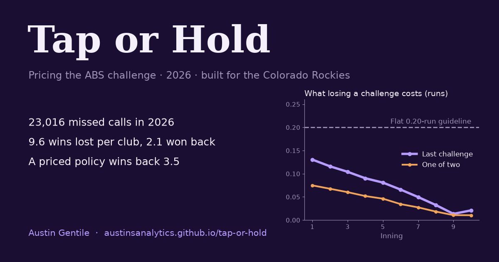

# Tap or Hold

**Pricing the ABS challenge.** A win-probability model of every 2026 ball-strike challenge decision, a season-replay
price for the challenge itself, and a dugout card built for the Colorado Rockies.

**Live site: [austinsanalytics.github.io/tap-or-hold](https://austinsanalytics.github.io/tap-or-hold/)** ·
[Printable dugout card (PDF)](https://austinsanalytics.github.io/tap-or-hold/assets/dugout-card.pdf)



## The question

A call goes against you and you have a challenge. Tapping can flip a call worth *V* in win probability, and a failed
tap costs the challenge, worth *D* for the rest of the game; a successful one is kept. So tap when your confidence
*p* clears

```
p  >=  D / (V + D)
```

*V* is a win-probability calculation. *D* is the hard part: Baseball Savant's public guideline fixes it at 0.20 runs.
This project estimates it for every game state by replaying the 2026 season.

## What it found (2026 regular season, 2,429 games)

| | |
|---|---|
| Called pitches the umpire missed, judged by the rebuilt ABS zone | **23,016** (6.2%) |
| Wins those misses took from each club | **9.6** |
| Wins clubs won back with challenges | **2.1** (22%) |
| Wins the dugout card wins back (cross-validated replay) | **3.5** (+1.4 per club per season) |
| Price of a club's last challenge, tie game: 1st / 7th / 9th inning | **0.13 / 0.05 / 0.01 runs** (flat guideline: 0.20) |
| Tap rate on clear misses, cheapest vs most valuable tenth (94x apart) | players 24% → 36%; card 13% → 85% |
| Challenges the rebuilt ABS zone reproduces | **7,888 of 7,891** (99.96%) |

- **Tap more, win less, gain more.** The card taps 2.8 times a game (clubs: 1.6) and wins only 40% (clubs: 56%).
  Most of the time a lost challenge is cheap, and one left unused at the final out is worth nothing.
- **Catchers should own defensive challenges:** catchers won 55% of 4,292 taps, pitchers 40% of 133.
- **Nobody adjusts to a tapped-out lineup.** By the 9th, 11% of pitches go to a lineup with no challenges left;
  umpires and pitchers behave exactly as before (pitcher fixed-effects LPM: +0.00 points, SE 0.08).
- **Coors Field raises the stakes, not the errors.** Calls are worth 8% more in the same state and four-seamers lose
  3.6 in. of ride, but umpires miss at the same rate and visitors challenge as accurately.
- **Rockies:** 5th in MLB in defensive challenge success (Hunter Goodman 53 of 81), 30th on offense.

## How it works

| Step | Script | What it does |
|---|---|---|
| 1 | `pipeline/fetch.py` | Downloads every 2026 pitch (Baseball Savant) and the MLB Stats API's per-pitch review records |
| 2 | `pipeline/parse_raw.py`, `sql/*.sql`, `pipeline/build_db.py` | DuckDB database; cleaning and joins in SQL; challenges left before every pitch; 13 data checks |
| 3 | `pipeline/values.py` | RE288 and a convolution win-expectancy model (league and a fitted Coors tilt); value of every call |
| 4 | `pipeline/zone.py` | Rebuilds the ABS verdict (ball radius and measurement plane fitted to 7,891 known verdicts); umpire zone map |
| 5 | `pipeline/perception.py` | Eyesight-and-willingness model of every challenge opportunity (maximum likelihood) and calibrated beliefs |
| 6 | `pipeline/policy.py` | Season-replay dynamic program for the value of a challenge; policy iteration; two-fold cross-validation |
| 7 | `pipeline/analysis.py` | League, Rockies, Coors, tapped-out (fixed-effects regression) and opponent analyses |
| 8 | `pipeline/export.py`, `story.py`, `card_pdf.py`, `og_image.py` | Site data, the page (every number templated from the outputs), the printable card |

Validation built in: the win-expectancy model matches Savant's published values (correlation 0.99986, Brier 0.1576 vs
0.1577); run values by count match Savant's (correlation 0.995); the browser's card logic matches the Python model on
spot checks; `tests/` covers the base-running, zone geometry and challenge-counting rules.

## Reproduce

Python 3.12 with the packages in `requirements.txt`.

```sh
pip install -r requirements.txt
make data     # about 40 minutes of politely paced downloads
make model    # database, models, replay (a few minutes)
make site     # writes site/ and runs the pre-publish check
make test
make serve    # http://127.0.0.1:8642
```

Raw and intermediate data are not committed (`data/raw`, the DuckDB file); everything in `site/` is regenerated
from them. `.github/workflows/pages.yml` checks the site and publishes `site/` to GitHub Pages.

## Limits

The replay keeps the rest of each real game fixed after a simulated flip, so values are first-order. Simulated players
hold calibrated beliefs; real ones don't always. Unused challenges cost nothing in the model, but taps have costs the
data can't see. Coors estimates rest on one season of 81 games.

---

By Austin Gentile. Built with Claude Code (Anthropic) as an AI pair programmer; every number is produced by this
pipeline and checked by its tests. Independent analysis, not affiliated with or endorsed by Major League Baseball or the
Colorado Rockies. Data: Baseball Savant and the MLB Stats API.
